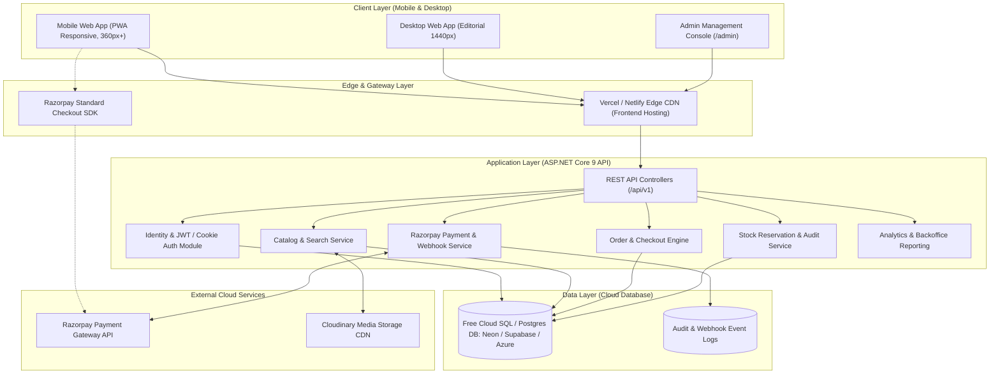

# Architecture Specification: Miraya Couture (Premium Fashion E-Commerce Platform)

## 1. Executive Overview

**Miraya Couture** is a mobile-first, editorial-grade Indian women's fashion e-commerce platform designed for discerning customers seeking bespoke ethnic wear, contemporary sarees, festive lehengas, and artisanal kurtis.

The solution is architected as a decoupled, full-stack application:
- **Frontend Client**: React 19 + TypeScript + Vite, styled using Tailwind CSS and shadcn/ui design patterns, state-managed with TanStack Query and Zustand, dynamic routing via React Router.
- **Backend API**: ASP.NET Core 9 Web API following Clean Architecture / Vertical Slice principles with Entity Framework Core 9.
- **Data Persistence**: Cloud Database (Free Cloud tier: Neon / Supabase PostgreSQL or Azure SQL Free Tier) configured with dual-provider capability (SQL Server and PostgreSQL through EF Core) so developers and owners are not bound to localhost.
- **Media Storage**: Cloudinary / AWS S3 for CDN-optimized multi-resolution fashion photography.
- **Payment Processing**: Razorpay Gateway (Indian UPI, Cards, NetBanking, Wallets) with server-side signature verification and idempotent webhook reconciliation.
- **Free Cloud Deployment**: Frontend on Vercel/Netlify; Backend on Render/Railway/Azure App Service Free tier; Database hosted on free managed cloud DB.

---

## 2. High-Level System Architecture Diagram

---

## 3. Technology Stack & Package Decisions

### 3.1 Frontend Stack
| Component | Technology | Version / Choice | Rationale |
| :--- | :--- | :--- | :--- |
| **Framework** | React + Vite | React 19 / Vite 6 | Instant HMR, minimal bundle footprint, modern React primitives |
| **Language** | TypeScript | v5.7+ | Strict type safety for complex cart, variant, and order models |
| **Styling** | Tailwind CSS v3.4 + shadcn/ui | Tailored HSL theme | Warm ivory (`#FBF9F5`), deep burgundy (`#722F37`), gold accents (`#C5A059`) |
| **Routing** | React Router | v6 / v7 | Dynamic product routes, nested admin layouts, protected routes |
| **Server State** | TanStack Query | v5 | Client-side caching, background refetching, optimistic updates |
| **Form Handling** | React Hook Form + Zod | Latest stable | Declarative validation with custom Indian pincode & phone rules |
| **Icons** | Lucide React | Latest | Clean, consistent, lightweight SVG stroke icons |

### 3.2 Backend Stack (.NET 9 C#)
| Layer | Technology | Rationale |
| :--- | :--- | :--- |
| **Runtime** | .NET 9.0 SDK (LTS Support) | High throughput, minimal memory overhead, native AOT compatibility |
| **Framework** | ASP.NET Core Web API | RESTful controllers, rate limiting, built-in dependency injection |
| **ORM** | Entity Framework Core 9 | Migration history, Linq queries, connection pooling, interceptors |
| **Database Provider** | Dual Provider: Npgsql.EntityFrameworkCore / Microsoft.EntityFrameworkCore.SqlServer | Enables connecting directly to free cloud DBs (Neon/Supabase) or Azure SQL |
| **Auth** | ASP.NET Core Identity + JWT Tokens | Secure BCrypt/PBKDF2 hashing, claims-based role authorization |
| **Documentation** | Swashbuckle OpenAPI / Scalar | Interactive API sandbox for QA and front-end integration |
| **Payment SDK** | Razorpay .NET SDK | Cryptographic HMAC-SHA256 signature verification |

---

## 4. Key Architectural Patterns

1. **Backend as Single Source of Truth**:
   The frontend never calculates final payable amounts, shipping fees, or coupon discounts. Every cart recalculation and checkout transaction is priced, validated, and signed on the server.
2. **Safe Two-Phase Inventory Allocation**:
   - *Phase A (Checkout Init)*: A temporary stock reservation (15-minute lease) is placed when the Razorpay order ID is created.
   - *Phase B (Payment Capture)*: Upon verified payment webhook or signature verification, stock reservation is committed to permanent inventory deduction.
   - *Phase C (Timeout / Failure)*: If payment is aborted or expires, a background reconciliation job or cancellation trigger releases reserved stock.
3. **Idempotent Webhook Processing**:
   Payment webhooks from Razorpay check `PaymentWebhookEvents` table. If `event_id` exists with status `PROCESSED`, the handler immediately returns HTTP 200 without duplicate execution.
4. **Mobile-First UX Constraints**:
   - 360px minimum viewport test boundary without horizontal scroll.
   - Fixed thumb-friendly bottom navigation bar for mobile viewports.
   - Sticky "Add to Bag" and "Buy Now" bottom bar on product detail pages.
   - Drawer-based filtering and sorting for instant accessibility.
