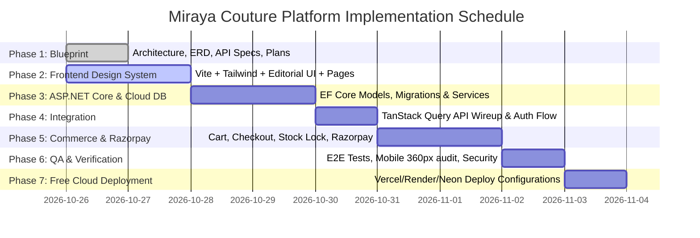

# Development Plan: Incremental Milestones & Delivery Roadmap

## 1. Incremental Phasing Plan

---

## 2. Work Breakdown Structure

### Phase 1: Architectural Blueprint (Current)
- Deliverables:
  - `architecture.md`: Clean architecture and tech stack choices.
  - `database-design.md`: 3NF relational schema and Mermaid ERD.
  - `api-guide.md`: OpenAPI REST standard, DTO contracts, Razorpay hooks.
  - `ui-page-map.md`: Mobile-first UX flows (360px test boundary), editorial design tokens.
  - `development-plan.md`: Step-by-step verified execution order.
  - `security-and-deployment-plan.md`: Free cloud hosting, database offloading, token security.

### Phase 2: Responsive Frontend Application (`/frontend`)
- Setup Vite React TypeScript application with Tailwind CSS and Lucide icons.
- Implement editorial design tokens: Ivory `#FBF9F5`, Burgundy `#722F37`, Gold `#C5A059`.
- Build core components:
  - Header with dynamic announcement ticker and search bar.
  - Mobile bottom navigation bar (Home, Explore, Wishlist, Bag, Account).
  - Product Card with quick add, wishlisting, variant swatches, and discount badges.
  - Slide-over Cart Drawer and Mobile Filter Sheet.
- Build complete responsive pages:
  - Home Page with Hero, Categories, Trending Drops, Testimonials.
  - Product Catalog (PLP) with live search, filters, and sorting.
  - Product Detail Page (PDP) with image gallery, size selector, size chart modal, and sticky buy bar.
  - Cart & Checkout pages with Razorpay payment sheet invocation.
  - Customer Account Dashboard (Orders, Saved Addresses, Wishlist).
  - Admin Portal (`/admin`) with metrics, product management, stock control, and order handling.

### Phase 3: C# ASP.NET Core 9 Backend API (`/backend`)
- Clean Architecture solution structure:
  - `FashionStore.Domain`: Pure entities, enums, domain exceptions.
  - `FashionStore.Infrastructure`: EF Core DbContext, migrations, repository implementations, Razorpay client.
  - `FashionStore.Application`: Business logic, DTOs, validation rules, stock management.
  - `FashionStore.Api`: Controllers, Swagger/Scalar configuration, JWT auth middleware, global exception handler.
- Cloud DB integration supporting free cloud providers (Neon/Supabase/Azure SQL).

### Phase 4: Full-Stack Integration
- Connect React frontend to ASP.NET Core endpoints via TanStack Query and Axios client.
- Auth state persistence with JWT token interceptors.
- Live category loading, product filtering, dynamic search queries.

### Phase 5: Checkout & Razorpay Integration
- Server-side Razorpay order creation (`/api/v1/orders/initiate-checkout`).
- Frontend invocation of Razorpay Standard Checkout SDK modal with test keys.
- HMAC-SHA256 signature verification endpoint (`/api/v1/orders/verify-payment`).
- Safe stock reservation and deduction with audit logs.

### Phase 6: Testing & Quality Assurance
- Backend unit tests (`FashionStore.Tests`) for stock locks, order math, signature verification.
- Frontend component and responsive testing (verifying 360px viewport).
- Automated build, test, and type-check runs.

### Phase 7: Free Deployment & Cloud Readiness
- Vercel/Netlify frontend configuration (`vercel.json`).
- Render/Railway backend `Dockerfile` and setup guide.
- Neon/Supabase PostgreSQL connection string guide and auto-migration run on startup.
