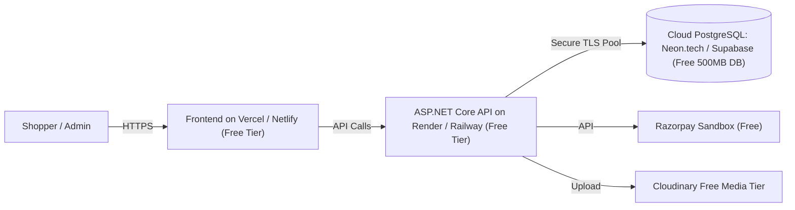

# Security & Free Cloud Deployment Plan: Miraya Couture

## 1. Security Architecture

### 1.1 Authentication & Authorization
- **JWT (JSON Web Token)**: Standard claims (`sub`, `email`, `role`, `exp`). Short-lived access tokens (60 minutes) combined with secure refresh token rotation stored in HttpOnly, SameSite=Strict cookies.
- **Role-Based Access Control (RBAC)**:
  - `Customer`: Restricted to their own profile, addresses, orders, and wishlist.
  - `Admin`: Access to backoffice endpoints (`/api/v1/admin/*`), product catalog modification, inventory balance updates, and order shipment dispatch.
  - Ownership validation on every mutation (e.g., verifying `address.UserId == currentUserId`).

### 1.2 Data Protection & Encryption
- **Payment Security**: Raw card numbers, CVVs, and banking credentials never touch the application server. Payment checkout uses the official Razorpay JS Checkout modal, and tokens/signatures are verified using server-side HMAC-SHA256 secrets.
- **Password Storage**: Argon2id or PBKDF2 with SHA-512 and unique cryptographic salts (handled by ASP.NET Core Identity).
- **Environment Isolation**: Production secrets (connection strings, Razorpay Key Secret, Cloudinary API secret) are injected strictly through runtime environment variables and are never committed to version control.

### 1.3 Threat Mitigation
- **SQL Injection**: Prevented by parameterized queries in Entity Framework Core.
- **Cross-Site Scripting (XSS)**: Prevented by React's native JSX escaping and DOMPurify sanitization for rich product descriptions.
- **CORS Policy**: Configured to whitelist authorized frontend origins (`https://miraya-couture.vercel.app`, `http://localhost:5173`).
- **Rate Limiting**: ASP.NET Core built-in rate limiter for `/api/v1/auth/*` and checkout endpoints to mitigate brute force attacks.

---

## 2. Free Cloud Hosting & Database Setup Guide

Per the user's specific requirement ("*database yellamee localhost la vaika venam ethavathu free server la vachukoo ... and website hosting um free ya panni kutu*"), this section details the free cloud hosting architecture:



### 2.1 Free Cloud Database Options
1. **Neon Serverless PostgreSQL (Recommended)**:
   - **Cost**: 100% Free Tier (0.5 GB storage, serverless compute, autoscaling down to zero).
   - **Setup**: Sign up at [neon.tech](https://neon.tech), create project `miraya-couture-db`, copy the pooling connection string:
     ```
     Host=ep-xxx.ap-southeast-1.aws.neon.tech;Database=neondb;Username=user;Password=pass;SSL Mode=Require;Trust Server Certificate=true
     ```
   - **Compatibility**: Direct support in backend via `Npgsql.EntityFrameworkCore.PostgreSQL`.
2. **Supabase Cloud PostgreSQL**:
   - **Cost**: Free Tier (500 MB database, automatic TLS).
   - **Setup**: Sign up at [supabase.com](https://supabase.com), create new project, obtain transaction pooler URI.

### 2.2 Free Frontend Hosting (Vercel)
- **Platform**: [Vercel.com](https://vercel.com)
- **Deployment**:
  1. Push code to GitHub repository.
  2. Import repository in Vercel.
  3. Set Root Directory to `frontend`.
  4. Build Command: `npm run build`.
  5. Output Directory: `dist`.
  6. Environment Variables:
     - `VITE_API_BASE_URL`: `https://your-backend.onrender.com/api/v1`
     - `VITE_RAZORPAY_KEY_ID`: `rzp_test_YourRazorpayKey`

### 2.3 Free Backend API Hosting (Render / Railway)
- **Platform**: [Render.com](https://render.com) (Free Web Service) or Railway Free Trial
- **Deployment**:
  1. Create a `Dockerfile` for ASP.NET Core 9.
  2. Link your GitHub repo to Render as a Web Service.
  3. Environment Variables:
     - `ASPNETCORE_ENVIRONMENT`: `Production`
     - `ConnectionStrings__DefaultConnection`: `<Your Neon/Supabase Connection String>`
     - `DatabaseProvider`: `PostgreSQL` (or `SqlServer`)
     - `Razorpay__KeyId`: `rzp_test_xxxxxx`
     - `Razorpay__KeySecret`: `xxxxxx`
     - `Jwt__SecretKey`: `<32+ char strong key>`

---

## 3. Razorpay Test Mode Verification Workflow

1. Register for a free Razorpay account at [dashboard.razorpay.com](https://dashboard.razorpay.com) and switch to **Test Mode**.
2. Generate **Key ID** and **Key Secret** under *Settings > API Keys*.
3. Test Checkout Flow:
   - Frontend calls `POST /api/v1/orders/initiate-checkout` with line items and shipping address.
   - Backend calculates subtotal, taxes, shipping, creates order in Razorpay API with amount in paise (`amount_in_inr * 100`), and returns `order_id`.
   - Frontend opens `Razorpay({ key, amount, order_id, prefill })`.
   - Customer completes test payment using standard Razorpay mock UPI/Netbanking.
   - Frontend receives callback `{ razorpay_payment_id, razorpay_order_id, razorpay_signature }`.
   - Frontend sends verification payload to `POST /api/v1/orders/verify-payment`.
   - Backend computes HMAC-SHA256 hash using `KeySecret` and verifies match.
   - If verified, order status updates to `Confirmed`, stock reservation becomes permanent deduction, and confirmation email/notification is issued.
