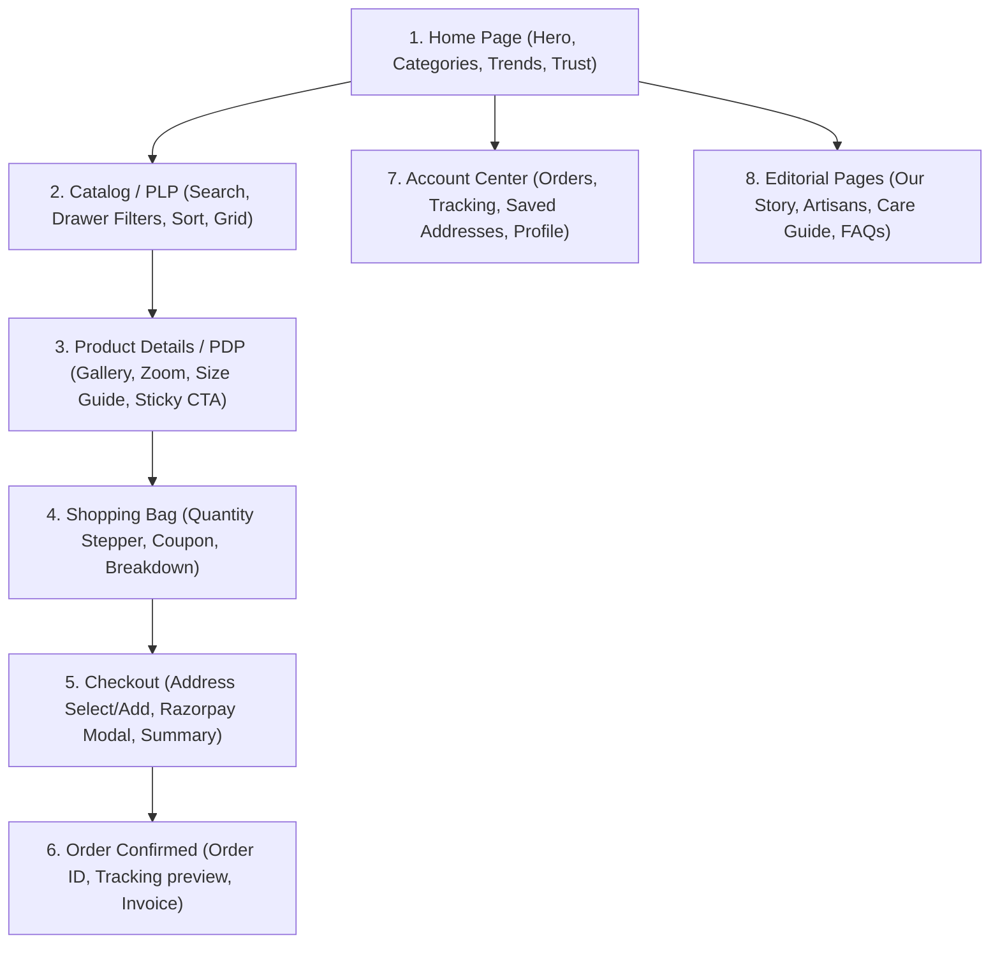

# UI Page Map & Mobile-First Design System: Miraya Couture

## 1. Design Direction: Editorial Indian Luxury Fashion

The visual identity is designed for an authentic Indian bridal & luxury ready-to-wear atelier:
- **Palette**:
  - `Canvas`: Warm Alabaster / Ivory (`#FBF9F5` / `#F8F5EE`)
  - `Accent / Primary`: Royal Bordeaux / Deep Crimson (`#722F37` / `#5B1924`)
  - `Accent Highlight`: Regal Antique Gold (`#C5A059` / `#D4AF37`)
  - `Text`: Rich Charcoal (`#1F1F1F`) and Warm Slate (`#615D58`)
  - `Surface / Border`: Subtle Warm Bisque (`#EFE9E0`)
- **Typography**:
  - Headings: Playfair Display / Cormorant Garamond (refined serif editorial typography)
  - Body & Interactive: Plus Jakarta Sans / Inter (crisp, readable, high legibility on 360px screens)

---

## 2. Customer-Facing Mobile-First Page Hierarchy

### 2.1 Mobile Bottom Navigation Bar (Persistent 360px+)
For users on mobile devices, a sleek glassmorphic navigation bar is pinned to the viewport bottom:
1. **Home** (`Lucide: Home`) -> Brand landing & editorial drops
2. **Explore** (`Lucide: Compass` / `Grid`) -> Categories & curated collections
3. **Wishlist** (`Lucide: Heart` with badge count) -> Saved ensembles
4. **Bag** (`Lucide: ShoppingBag` with live item count badge) -> Slide-over or bag page
5. **Profile** (`Lucide: User`) -> Account dashboard, orders & address book

---

## 3. Screen-by-Screen Functional Specifications

### 3.1 Home Page
- **Hero Banner**: High-resolution editorial showcase ("The Festive Splendour '26 Collection") with direct call-to-action button.
- **Shop by Category Strip**: Circular / rounded-pill horizontal scrollable cards (Bridal Lehengas, Banarasi Sarees, Embroidered Anarkalis, Contemporary Kurta Sets, Fusion Co-ords).
- **Featured Drops / Trending**: Two-column mobile grid / four-column desktop grid with discount badges, price in ₹ (INR), and quick-wishlist heart icon.
- **Artisan Story**: Editorial section highlighting handcrafted zardozi, chikankari, and pure handloom fabrics.
- **Trust Elements**: Free India Express Delivery, 7-Day Easy Exchange, 100% Authentic Handloom certified.

### 3.2 Product Listing Page (PLP)
- **Top Sticky Bar**: Live search input, category chip pills, item count indicator.
- **Filter & Sort Drawer (Mobile)**:
  - Slide-up bottom sheet on mobile (accessible via quick touch).
  - Filters: Category, Price Range Slider, Sizes (XS to XXL), Fabrics (Silk, Georgette, Chanderi, Velvet), Occasions.
  - Sorting: Price: Low to High, Price: High to Low, Newest First, Customer Rating.
- **Product Card**:
  - 3:4 aspect ratio image container with subtle hover/tap zoom.
  - Title, fabric material snippet, selling price, crossed-out MRP, discount tag `% off`.
  - Color variant swatches (clickable).

### 3.3 Product Details Page (PDP)
- **Mobile Multi-Image Carousel**: Swipeable high-res imagery with pagination dots and pinch-to-zoom / tap-to-expand modal.
- **Variant Selector**:
  - Color swatches with active ring indicator.
  - Size selection pill buttons with low-stock badges ("Only 2 left!").
  - "Size Chart & Fit Guide" modal with bust, waist, and hip measurements in inches/cm.
- **Sticky Bottom Action Bar (Mobile Essential)**:
  - Fixed at viewport bottom with price summary, "Add to Bag", and "Buy Now" (opens instant checkout).
- **Collapsible Accordions**:
  - Fabric & Handcraft Details (Zari, embroidery, lining material).
  - Wash & Care Instructions (Dry Clean Only).
  - Shipping & Easy Returns Policy.
- **Customer Ratings & Photo Reviews**: Verified buyer reviews with star ratings and feedback.

### 3.4 Shopping Bag & Checkout Flow
- **Bag**:
  - Transparent item breakdown with size/color modification.
  - Real-time coupon promo box with instant validation ("FESTIVE15" - 15% Off).
  - Delivery estimate calculator by entering 6-digit Pincode.
- **Checkout**:
  - Step 1: Delivery Address (Select saved or add new with GPS/Pincode autofill).
  - Step 2: Payment Method (Razorpay - UPI / Google Pay / PhonePe / Cards / NetBanking or COD toggle if enabled).
  - Step 3: Final confirmation with instant Razorpay modal invocation.

---

## 4. Admin Management Dashboard Pages (`/admin`)

1. **Dashboard Home**: Real-time sales graph, order metrics, inventory alerts, top-selling dress styles.
2. **Catalog Management**: Add/Edit product with multi-image dropzone, variant matrix (size x color), and SKU generator.
3. **Inventory Control**: Live stock adjustments, low-stock threshold triggers, audit log table.
4. **Orders Desk**: Kanban / table view of customer orders (`Placed` -> `Confirmed` -> `Shipped` -> `Delivered`).
5. **Coupons & Offers**: Create discount rules, percentage/flat discounts, expiry limits.
